<p>
  
</p>

**Review for sound and picture.**

Hekate is an open-source, self-hosted media review and approval system: a sovereign alternative to Dropbox Replay and Frame.io. Upload a cut, a mix or a score, invite reviewers, and collect feedback where every comment is anchored to an exact place in the media. Approve a version when it is right.

Classical music is a first-class citizen (bar numbers, score pages, tracks, movements, takes, a recording synced to its score), and Hekate works just as well for video and for general documents. It should never feel like a classical-music-only tool.

> **Status:** pre-release. The foundations are being built; nothing here is production-ready yet.

## What makes it different

- **Anchored comments.** Every comment carries an anchor: a time range or frame, a region of a PDF page, a bar and beat, a track or movement. Feedback always points at something.
- **Project profiles.** A project picks a profile (Music, Video or General) which decides which tools appear. The model underneath is the same.
- **Yours to run.** One app image, PostgreSQL and Caddy, deployed with Docker Compose. Local storage by default, S3-compatible storage if you want it.
- **Multi-tenant from day one.** Every record belongs to an organisation, so a hosted offering can follow without a rewrite.

## Stack

TypeScript end to end.

| Layer | Choice |
| --- | --- |
| Web | React, Vite, TanStack Router and Query, shadcn/ui on Tailwind (restyled to the Hekate system) |
| API | Hono, with types shared with the web app |
| Data | PostgreSQL with Drizzle ORM |
| Jobs | pg-boss, with a built-in ffmpeg worker for transcodes, waveforms and thumbnails |
| Media | Vidstack (video), wavesurfer.js (audio), pdf.js (scores and documents) |
| Auth | Better Auth |
| Storage | Local disk, optional S3 |
| Deploy | One app image, PostgreSQL and Caddy via Docker Compose |

## Repository layout

```
apps/
  server/     Hono API, job runner and static host for the web build
  web/        React single-page app
packages/
  shared/     Domain types and validation shared by server and web (anchors, profiles)
  db/         Drizzle schema, migrations and database client
brand/        Mark, wordmark and icons (SVG)
docs/         Decisions and the brand system
deploy/       Docker Compose and Caddy configuration
```

## Development

Requirements: Node.js 22, pnpm 10, and Docker for PostgreSQL.

```sh
pnpm install
docker compose -f deploy/compose.dev.yml up -d   # PostgreSQL on localhost:5432
cp .env.example .env
pnpm db:migrate
pnpm dev                                         # API on :3000, web on :5173
```

Checks:

```sh
pnpm check      # lint, typecheck and tests across the workspace
```

## Self-hosting

```sh
cp .env.example .env    # set HEKATE_DOMAIN, secrets and storage
docker compose -f deploy/compose.yml up -d
```

## Licence

Hekate is free software under the [GNU Affero General Public License v3.0](LICENSE). If you run a modified version as a network service, you must offer its source to the people who use it.
